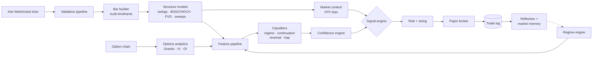

# NSE Market Intelligence v1

**The foundation of a market-intelligence model for Indian index options (BankNifty / Nifty). v1 built the
model's senses and its first reasoning layer: a real-time, event-driven perception pipeline, causal market
structure models, options analytics, multi-timeframe context, ML classifiers, and a paper-trading loop to
grade its decisions.**

[](https://github.com/Madhubala1985/nse-market-intelligence-v1/actions/workflows/tests.yml)


> v1 is the **prototype**. Its successor, **[NSE Market Intelligence v2](https://github.com/Madhubala1985/nse-market-intelligence-v2)**,
> ran autonomously against live market data on a cloud VM every trading day.

---

## Architecture



Every component communicates through frozen, JSON-safe Pydantic event envelopes on an async event bus that
enforces non-decreasing timestamps, so live runs and historical replays go through exactly the same code.

| Module (`platform_core/`) | What it does |
|---|---|
| `core/` | Enums, constants, immutable event envelopes (the only cross-service contract), protocols, settings |
| `orchestration/` | Async event bus, dependency-ordered service lifecycle, main orchestrator |
| `data/` | WebSocket ingestion, tick validation, bar and multi-timeframe builders, option-chain ingestion, Redis / PostgreSQL / TimescaleDB interfaces, replay engine |
| `analytics/` | Causal market structure: swings, BOS/CHOCH, fair-value gaps, liquidity sweeps, support/resistance |
| `options/` | Greeks, IV and IV surface, open interest, gamma exposure, dealer hedging, premium behaviour |
| `intelligence/` | Higher-timeframe bias, rolling bias, market context builder |
| `ml/` | Feature pipeline; regime, continuation, reversal and trap-probability classifiers; confidence engine |
| `adaptive/` | Regime engine, adaptive policy engine, market memory, reflection engine |
| `signals/` · `risk/` | Signal engine; position sizing, drawdown protection, portfolio heat, kill switches |
| `execution/` | Order manager, retry logic, latency monitor, fail-safe exits, reconciliation |
| `backtesting/` · `paper_trading/` · `testing/` | Historical replay and batch backtests; paper broker and performance tracker; Monte Carlo and latency simulation |

## Results (honest)
- The full pipeline ran end to end, from raw 1-minute BankNifty data through structure detection, features, signals, sizing and simulated execution, with a P&L log.
- The early paper run on real data (`logs/paper_trades.csv`, 15 trades) was a **small, mixed sample with no demonstrated edge**.
- What v1 taught directly shaped v2: the higher-timeframe bias went stale, session boundaries created bar artifacts, exits needed better modelling, and every new idea needed an out-of-sample gate before it could influence decisions.

## What this project demonstrates
- Designing a modular, event-driven system (orchestrator, event bus, dependency injection) where live and replay share one code path
- Real-time data engineering: WebSocket ingestion, validation, multi-timeframe aggregation
- Feature engineering and classifier design on market structure and options data
- Broker API integration (Zerodha Kite Connect: session generation, historical data, orders)

## Quick start
```bash
python -m venv .venv && source .venv/bin/activate
pip install -r requirements.txt
pytest
python scripts/run_backtest.py          # replay on the bundled BankNifty sample
# Live paper mode needs your own Kite Connect app:
cp configs/kite_config.example.json configs/kite_config.json
python scripts/generate_kite_session.py
python scripts/run_live_paper.py
```

## Related projects
| Project | Domain | Focus |
|---|---|---|
| [XAU Market Intelligence](https://github.com/Madhubala1985/xau-market-intelligence) | Gold, MT5 | Statistical validation of what a model is allowed to learn |
| **NSE Market Intelligence v1** (this repo) | Indian index options | Foundation: event-driven perception and context pipeline |
| [NSE Market Intelligence v2](https://github.com/Madhubala1985/nse-market-intelligence-v2) | Indian index options | Live autonomous model on cloud infrastructure, LLM analyst benchmark |

---
*Built with AI pair-programming (Claude Code). Research and education only; not financial advice.
No real-money orders were placed.*
